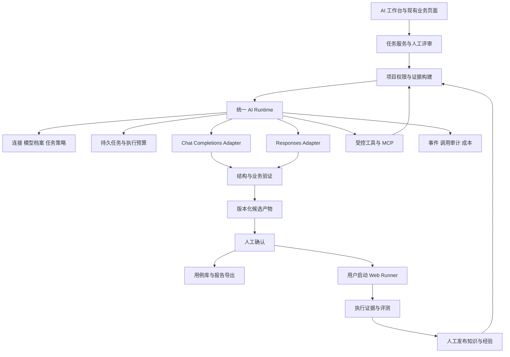

> **Archival record:** Preserved historical design/evidence from its original point in time. It does not claim Hermes integration is implemented.

# 完整 AI 测试平台改造计划

**状态：第二轮复审有条件通过；本文件不表示功能已实现或业务故障已解决。必须先通过 T-Review-1–T-Review-5 与 A01a–A20 门禁。**

**Goal：** 在现有 haitlify-API 上交付可切换模型、能理解需求与证据、能调用受控工具、能生成并评审测试资产、能恢复长任务、能追溯质量与成本的 AI 测试工作台。

**Architecture：** 保留 Spring Boot 模块化单体、Vue 工作台和独立 Web Runner。增加统一 AI Runtime，将连接、模型能力、协议适配、输出验证、执行预算、取消恢复和审计收敛到同一个调用边界；业务模块只提供任务、证据和输出契约。

**Tech Stack：** Java 21 / Spring Boot 4.1 / Jackson 3 / JDBC / Flyway / MySQL；H2 仅承担快速测试与已有本地开发兼容；Vue 3 / TypeScript / Vitest / Playwright；Node Web Runner。

**执行方式：** 按配套 [逐项实施清单](./2026-09-16-ai-platform-implementation-tasks.md) 顺序执行，每项完成测试与独立提交后推进。现在只交付计划，实施需用户后续指令。

**基线：** 本地分支 `ui/beauty-redesign-home`，提交 `382b63f`。参考 lemon-TestPilot 提交 `d185e077861f58f4fda71e9ad5763463e69407c3`。日期 2026-09-16。

## 1. 需求定义与完成边界

“完整 AI”在本计划中指可交付的测试业务闭环，不等于训练基础模型，也不等于给每个菜单加一次聊天请求。规划采用以下产品假设，评审时可调整范围，无需在本轮反复确认。

| 编号 | 用户能力与结果 | 完整交付条件 | 实施任务 |
|---|---|---|---|
| R01 | 配置连接并切换模型 | 同协议换模型无需改业务代码；不兼容能力在运行前指出 | T01–T04、T11 |
| R02 | 一处验证配置是否能完成任务 | 网络可达、文本生成、业务 JSON、视觉/工具能力分项报告；HTTP 200 不等于可用 | T04、T11 |
| R03 | 导入文本、Word/PDF、表格、图片、Figma、接口定义 | 保存来源位置与解析覆盖；图片/表格缺失必须可见 | T08 |
| R04 | 需求分析、测试点与追溯矩阵 | 原文事实、推断、待确认分离；每条结果具有可验证来源 | T07–T08 |
| R05 | 生成接口、功能、Web 用例并评审交付 | 契约有效、人工确认、模板正确、可入库导出；Web 额外需当前页面证据 | T07、T10 |
| R06 | AI 助手支持 Bug、日志、SQL、回归、报告、Prompt 评测 | 每种任务有真实执行器、输入要求、输出 schema 与样例验收 | T12–T13 |
| R07 | Skill、Agent、工具与 MCP 可实际使用 | 能力不靠名称声称；有调用记录、真实结果、版本与授权 | T09 |
| R08 | 长任务可见、可取消、可恢复、可重试 | 不丢已完成产物、不重复落库、不在取消后继续发请求 | T05–T07 |
| R09 | 多 Agent 协作能解释产物如何形成 | DAG 节点区分规则/模型/人工，输入输出契约与失败传播明确 | T09、T12 |
| R10 | 知识复用与经验学习 | 项目隔离、带引用检索、人工确认发布、禁用后不进入新任务 | T08–T09 |
| R11 | 知道失败在哪、花费多少、质量是否改善 | attempt 级诊断、真实 usage、预算控制、评测基线 | T05–T06、T13 |
| R12 | 升级后数据、权限、历史可用 | 向前迁移、回滚演练、发布版本可见、历史可查 | T01、T14–T15 |
| R13 | 真实 AI 结果可判定 | 任何业务产物都有原产地、接受状态和字段来源；规则/降级不能伪装模型成功 | T-Review-3、T07–T12 |
| R14 | 模型切换可证明 | 有 Provider Contract Matrix，同一脱敏输入可比较不同档案的协议、能力、usage、质量和失败原因 | T-Review-1、T-Review-2、T04、T13 |
| R15 | 真实长任务运行 | claim、lease、续租、恢复、并发、停机、指标有固定实现和 MySQL 集成证据 | T-Review-4、T06、T15 |
| R16 | AI 质量可复现 | Gold Set、rubric、人工一致性和版本绑定先于规模化评测 | T-Review-5、T13 |

本期完整交付包含上表全部能力。顺序分为“可靠底座”“测试资产闭环”“通用 QA 助手与质量闭环”三个里程碑，不能在第一个里程碑后宣称完整 AI 已完成。

范围边界：原生 App 自动化、负载测试执行引擎、训练/微调基础模型、多租户 SaaS 计费、无限自主生产操作不纳入本轮。可以生成相关人工测试设计，但必须标识“设计产物”，不能声称已自动执行。项目/用户隔离是本轮强制要求；不以尚未存在的租户体系替代现有项目权限。

## 2. 现状证据与事故结论校正

以下为源码事实；文件存在只证明实现入口存在，不证明端到端完成。行号对应本计划基线，实施后可能移动。

| 证据 | 当前事实 | 设计影响 |
|---|---|---|
| [GatewayConfig](/path/to/Haitlify/server/platform/src/main/java/com/haitlify/aitest/platform/ai/gateway/AiGatewayConfig.java:3) | 只携带 provider/address/model/key/timeout 等少量字段 | 缺协议、能力、参数策略及任务契约 |
| [Adapter](/path/to/Haitlify/server/platform/src/main/java/com/haitlify/aitest/platform/ai/gateway/OpenAiCompatibleAdapter.java:74) | 单 user 消息、固定 temperature=0.1、阻塞非流式请求 | 任意模型共用一套参数假设 |
| [端点解析](/path/to/Haitlify/server/platform/src/main/java/com/haitlify/aitest/platform/ai/gateway/OpenAiCompatibleAdapter.java:219) | 固定补 `/chat/completions` | 不能通过填 Responses URL 获得 Responses 支持 |
| [连接探针](/path/to/Haitlify/server/platform/src/main/java/com/haitlify/aitest/platform/ai/gateway/OpenAiCompatibleAdapter.java:45) | 1 token ping，2xx 就成功 | 无法代表长业务输出，也不检查非空与 schema |
| [结构验证](/path/to/Haitlify/server/platform/src/main/java/com/haitlify/aitest/platform/ai/gateway/AiStructuredOutputValidator.java:33) | 验证 type/required/properties，未遍历 array items 等完整规则 | 名为 schema 校验，实际覆盖不足 |
| [worker](/path/to/Haitlify/server/platform/src/main/java/com/haitlify/aitest/platform/ai/analysis/AiAnalysisWorker.java:180) | 返回后验根节点与数组，再尝试修复 | 未完整区分截断、拒绝、空内容、业务不合格 |
| [调度器](/path/to/Haitlify/server/platform/src/main/java/com/haitlify/aitest/platform/ai/analysis/AiAnalysisRunDispatcher.java:19) | 内存 Future 与单线程执行器 | JVM 重启后需要额外恢复机制 |
| [重试执行器](/path/to/Haitlify/server/platform/src/main/java/com/haitlify/aitest/platform/ai/gateway/AiRouteExecutor.java:34) | 有预算与备用路由，但在内部循环中未接收任务取消令牌与总 deadline | 中断分类、取消与重试边界不统一 |
| [配置保存](/path/to/Haitlify/server/platform/src/main/java/com/haitlify/aitest/platform/ai/config/AiConfigService.java:95) | 最近补丁将连接 timeout 同步到默认策略 | 解决旧值残留，但覆盖显式策略值的语义仍不清楚 |
| [UI 配置](/path/to/Haitlify/apps/web/src/domain/aiConfigRepository.ts:23) | 存在 customHeaders/contextWindow/skipTLSVerify 等字段 | 必须逐项核实是否到达实际调用，不能只保存不生效 |
| [MCP 执行器](/path/to/Haitlify/server/platform/src/main/java/com/haitlify/aitest/platform/ai/tool/mcp/AiMcpToolExecutor.java:34) | 校验后直接回显 arguments 与 executed=true，没有远端工具调用 | 必须完成真实传输；占位路径不得报成功 |
| [静态工具](/path/to/Haitlify/server/platform/src/main/java/com/haitlify/aitest/platform/ai/tool/internal/StaticInternalAiTool.java:58) | 模板匹配/覆盖检查 dryRun 仅返回 textLength | 不能当作已验证的工具能力 |
| [Figma 分析](/path/to/Haitlify/server/platform/src/main/java/com/haitlify/aitest/platform/ai/figma/AiFigmaAnalysisService.java:81) | 基于节点 mapper 生成候选 | 规则提取应保留，语义 AI 分析需独立标识 |
| [多 Agent](/path/to/Haitlify/server/platform/src/main/java/com/haitlify/aitest/platform/ai/agent/AiMultiAgentRunService.java:193) | 部分评审直接调用默认 gateway | 尚未全部接入统一路由/取消/预算 |
| [配额](/path/to/Haitlify/server/platform/src/main/java/com/haitlify/aitest/platform/ai/quota/AiQuotaService.java:21) | 汇总 call/token/cost | 用量报表不等于预算预留和阻断 |
| [质量评分](/path/to/Haitlify/server/platform/src/main/java/com/haitlify/aitest/platform/ai/quality/AiQualityScoreService.java:33) | 部分分数来自固定阈值规则 | 需公开评分来源，不能称真实模型评审或测试通过率 |
| [来源导入](/path/to/Haitlify/server/platform/src/main/java/com/haitlify/aitest/platform/ai/document/AiSourceDocumentService.java:48) | 文档入口调用 parser，image 类型单独关联视觉资产 | 容器文档内嵌图表、位置与访问权限须专项验收 |
| [项目权限](/path/to/Haitlify/server/platform/src/main/java/com/haitlify/aitest/platform/auth/ProjectAccessService.java:21) | 有项目访问校验能力 | 所有新旧 AI 对象与后台执行需接入，而不是再造身份体系 |

事故证据必须限定结论：曾观察到 GPT-5.5 成功、GPT-5.6-sol 在约 90 秒收到 503、在另一次调用 120 秒超时，以及 2xx 空响应。另一次 Responses 探针报告 `No available channel for model: gpt-5.6-sol`，只证明该次路由失败，不能证明模型永远不可用或凭证必须重新开通。小提示词成功不能推导 token 上限是根因；提高 timeout 也不能解决上游 503。此前这两项因果结论不成立，不进入新设计前提。

完整业务重放还需统一网络环境、同一 endpoint/凭证引用、精确提示词 hash、相同协议与参数，避免 MySQL batch 转义改变提示词。计划阶段不再发送真实需求或凭证到外部做试探。

## 3. 如何参考 lemon-TestPilot

参考固定提交的 [server.mjs](https://github.com/summerliu90/lemon-TestPilot/blob/d185e077861f58f4fda71e9ad5763463e69407c3/server.mjs#L111)、[业务入口](https://github.com/summerliu90/lemon-TestPilot/blob/d185e077861f58f4fda71e9ad5763463e69407c3/src/main.tsx#L117)、[工作台编排](https://github.com/summerliu90/lemon-TestPilot/blob/d185e077861f58f4fda71e9ad5763463e69407c3/workbench-api.mjs)。采用其“清晰任务入口、输入完整性、provider 参数可见、知识引用、人工复核、固定回归案例”的产品组织。

不将该项目视为已证明的模型兼容基准：连接测试只请求 models；AI 空内容以 `{}` 兜底；前端失败后使用本地规则；工作台部分步骤由本地 buildOutput 直接产生并统一标完成。因此我们不复制“页面可操作就等于真实 AI 完成”的语义。

对外同时展示 `executionKind=MODEL/RULE/TOOL/HUMAN` 与 `resultOrigin=MODEL_GENERATED/RULE_EXTRACTED/HUMAN_EDITED`。有降级则显示 `DEGRADED` 和缺失能力；规则提取事实可用，但不能替代要求模型评审的必经节点。

## 4. 架构决策

| 方案 | 优点 | 成本/限制 | 决定 |
|---|---|---|---|
| 继续扩展现有单一 adapter | 改动小 | 请求语义继续散落，无法覆盖真实工具与恢复 | 仅可短期排错，不作为完整方案 |
| 在现有单体内建设统一 Runtime | 复用认证、项目、数据、Runner；迁移可分批 | 需要明确契约与双路径兼容 | 推荐 |
| 全面替换为外部 Agent 平台/模型代理 | 可能减少部分协议维护 | 新部署、密钥与证据流动、持久化与权限重做；不能证明能解决当前公司路由 | 保留接口扩展，不作为先决条件 |

### 4.1 模块关系



业务入口不得自己拼 URL、载入明文 key、重复实现重试或忽略取消。协议 adapter 只处理请求/响应协议；Runtime 决定路由、权限、预算、schema 和副作用边界。Job 负责持久生命周期，Attempt 负责一次模型调用，不混用两者的状态。

### 4.2 配置模型与优先级

| 对象 | 必需字段 | 规则 |
|---|---|---|
| Connection | id、version、baseUrl、credentialRef、protocol、enabled、allowedProjects、networkPolicy、headerRefs | 一项连接可服务多个模型；protocol 显式指定，禁止按模型名猜 |
| ModelProfile | id、version、connectionId、modelId、capabilities、parameterPolicy、limits、verification | modelId 为上游原样名称，不做 GPT 名字分支 |
| TaskPolicy | id、version、taskType、projectScope、routes、timeouts、retry、repair、budget、fallback | 路由引用 ModelProfile；项目覆盖须在系统允许范围内 |
| SkillVersion | id/version、taskType、instruction、input/output schema、toolAllowlist、evidencePolicy | 发布版本不可变，草稿不进入生产任务 |
| RunSnapshot | config/profile/policy/skill/schema 版本、effectiveOptions、actor、scope、inputHash | 不存 key/header 值；运行中配置更新不改变已开始任务 |

参数解析次序：平台安全上限约束所有来源；显式任务覆盖 > Agent 所选模型档案 > 任务策略所选档案 > 档案参数 > 协议默认（省略字段）。每个最终参数记录来源。`null` 表示继承；`0` 是否无限仅适用于明确支持的 timeout 字段，并仍受任务总预算约束；绝不能使用 `value || default` 让 0/false 消失。

每个能力为 `UNKNOWN/DECLARED/VERIFIED/UNSUPPORTED`，包含检查时间、配置版本及证据；探针过期不能自动更改协议。核心能力：text、image input、json_object、json_schema、tool_calls、streaming、background；reasoning 参数单独列 allowedValues 与可省略性。未知能力默认不发送可选参数。配置能力不匹配时返回可操作的 BLOCKED 原因。

支持两个真实协议 adapter：Chat Completions 与 Responses。DeepSeek/Qwen/本地兼容网关仅在通过相应协议验证后可选择；其 provider 名称不等于支持声明。Anthropic/Gemini 原生协议不伪装成 OpenAI；在本期 UI 标注原生适配未启用，兼容网关按真实协议接入。两个协议都必须通过本地 contract 与 fixture 测试；每个部署至少要有一个当前任务所需的真实协议+能力档案通过业务级验证。外部环境未开通的协议或模型标记为 `BLOCKED/UNKNOWN`，不能阻塞已验证档案，也不能在 UI 显示为支持。

temperature、输出 token、reasoning effort、JSON mode、stream 都是可省略配置。参数映射由协议和档案决定：Chat 使用已验证的 max_tokens 或 max_completion_tokens；Responses 使用 max_output_tokens，字段不能一起发送。没有设置输出上限时不注入 8192 等常量；预算仍通过请求次数、时间、上下文和配额预留约束。

### 4.3 统一调用契约

以下为目标 Java 契约，实施时置于 `ai/runtime/AiRuntimeModels.java`；其余内部类型不暴露给业务调用方。

```java
record AiTaskRequest(
    String taskType, Long projectId, String actorId, String runId,
    String skillVersionId, String schemaId, String schemaVersion,
    List<String> evidenceIds, JsonNode input, String idempotencyKey
) {}
record AiTaskResult(
    String runId, String state, String resultOrigin,
    JsonNode validatedOutput, List<String> evidenceIds,
    String artifactId, String failureCategory, String diagnosticId
) {}
interface AiRuntime {
    AiTaskResult execute(AiTaskRequest request, AiExecutionControl control);
}
interface AiExecutionControl {
    boolean cancellationRequested();
    long remainingMillis();
}
```

actorId/projectId 由服务器已授权上下文构造，不信任模型或前端字段。业务 schema 来自注册版本，不能由任意用户将验证关掉。多模态输入通过 evidenceIds 由受控 resolver 构建。网络过程不持有数据库长事务。外部 API 仍返回 runId，长调用由持久 worker 执行。

协议响应先归一化 `status/text/toolCalls/finishReason/refusal/usage/providerRequestId`，再做契约验证。Responses 必须扫描 typed output items，只接收最终 message/output_text；reasoning/tool items 不能直接当最终答案。Chat 检查 finish_reason 与 tool_calls。usage 缺失记 UNKNOWN，不记 0；只存可见决策摘要，不存隐藏推理。

### 4.4 三层验证与能力探针

1. 连接检查：DNS/TLS/认证/路径，models 列表只是发现信息。
2. 生成检查：使用无业务隐私的固定短任务，校验非空、完成状态、真实 model/usage；发生拒绝或 incomplete 不算成功。
3. 业务能力检查：使用固定脱敏样例输出 2 条测试点并通过 item/schema 与证据关联检查；视觉和工具档案需分别做图片/只读工具探针。

探针复用生产 adapter 和参数解析器，结果绑定 connection/profile 版本与时间，展示 pass/fail/unknown/unsupported。测试连接不自动保存、不自动启用、更不替换所有任务模型。发布连接与切换路由独立操作。失败不覆盖上一版可用档案。

structured output：支持 native schema 则按协议下发；仅 JSON mode 支持者使用 JSON mode+本地 schema；只支持文本者显式标为 prompt-json 模式并严格本地验证。不支持必需能力的备用模型不能入选。采用明确 JSON Schema 方言及兼容 Jackson 3 的验证库适配层，验证 items/enum/additionalProperties/bounds/required；协议不支持的 schema 关键字在发送前拒绝或经有测试的编译器转译，不能静默删约束。

业务校验包括来源 ID 属于当前输入、project 一致、标题/步骤/断言非空、模板字段类型、引用可访问、结果条数约束。空数组仅在带可追溯的 no_findings 原因且任务允许时成立。Markdown 包裹只剥离完整外层 fence，不用贪婪正则截取 JSON。截断优先报告/分片，不把缺损事实补造为成功；结构 repair 有独立预算上限 1 次（可调），必须保留来源并重验全部契约。

所有业务产物必须由统一的接受模块判定。`MODEL_GENERATED` 要求至少一次 Runtime attempt 返回非空、完成且通过 schema/业务验证；`RULE_EXTRACTED` 只能表示来源解析或确定性算法；`TOOL_OBSERVED` 必须有真实 toolCallId/evidenceId；`HUMAN_EDITED` 必须保留 parentArtifact；`DEGRADED` 必须列出跳过的能力；`BLOCKED` 不得进入交付；`ACCEPTED` 表示人工确认；`EXECUTED` 只表示用户启动后获得执行证据。字段级来源另标 `MODEL_PROPOSED/RULE_COMPUTED/TOOL_OBSERVED/HUMAN_REQUIRED`，其中报告 pass rate、上线结论、SQL 已执行结论永远不能由模型直接写成事实。

### 4.4a 实施前真实垂直切片与兼容矩阵

在扩展 MCP、Figma 和七类助手前，先完成一个真实闭环：一个连接、一个模型档案、一个脱敏需求、一个 skill/schema、一个 Runtime invocation、一个真实 attempt、一个测试点 artifact、一个人工确认。T01/T02 先提供最小 connection/profile/protocol seam；T-Review-1 使用 Runtime 的确定性测试 harness 验证真实调用和产物语义，持久 Job 的 lease/recovery 由 T-Review-4 单独证明。它必须在与目标部署相同的 endpoint/credentialRef/协议下完成，并能显示 `MODEL_GENERATED/BLOCKED/DEGRADED`。失败时停止扩展，不用 mock、ping 或规则输出替代。

同时维护 `docs/ai-test-platform/provider-compatibility-matrix.md`。每个 provider/protocol/profile/能力单元格必须记录：脱敏输入 hash、时间、profile/config version、requestId、HTTP/完成状态、usage（未知也要明确）、schema outcome、evidence outcome、latency、结论和阻塞原因。GPT-5.6-sol 当前无成功证据只能标 `BLOCKED/UNKNOWN`。模型切换的证明必须使用同一脱敏输入、skill/schema 和明确的 endpoint/credentialRef；只改 model 字符串、只请求 models、只发 1 token ping 都不算。

### 4.5 持久执行、重试与取消

任务状态：`QUEUED → PREFLIGHT → RUNNING → WAITING_REVIEW → SUCCEEDED`。附加 `BLOCKED/FAILED/CANCEL_REQUESTED/CANCELLED/PARTIAL`；`DEGRADED` 为结果属性。Web 子阶段继续遵循项目 AGENT.md 的 PREFLIGHT/EVIDENCE/PLANNING/GENERATION/VALIDATION/DELIVERY。任务生成完成与用例人工接受、实际运行通过为不同状态。

- 使用 MySQL job 表、短事务领取、leaseOwner/leaseUntil/fencingToken 与 compare-and-set 状态版本。H2 单机测试不替代 MySQL 双 worker 并发测试。
- worker 崩溃由 lease 过期接管；所有产物以 `(runId,nodeId,sourcePointId,artifactRevision)` 唯一键提交。过期 worker 的 late response 不能覆盖新 lease 结果。
- 只读模型调用可按预算重试；已经确认落库的节点不重复执行。网络超时不意味着上游未计费，记录 delivery/usage unknown；不能承诺外部调用 exactly-once。
- 每次请求、退避、修复、工具调用之前及返回后都检查 cancellation 与 deadline。cancel 请求应在 2 秒内阻止新请求；取消 HTTP future/stream，不能把 InterruptedException 转成普通网络错误继续重试。5 秒内显示本地 CANCELLED；上游不可取消则明确显示停止本地等待、远端结果未知，不纳入正式产物。
- timeout 分为 connect、first-response、stream-idle、attempt-total、run-total；单次有效时限为 min(配置单次时限, run 剩余时限)。每个 Agent、备用路由、repair 和 MCP 都消费同一个 ledger。
- 一个配置控制重试总量，SDK/HTTP 库内置重试关闭或纳入同一预算，防止三层重试放大。
- SSE/WebSocket 输出仅在协议已验证后启用；心跳只表示 worker 存活，不能显示为模型已开始生成。网络中断后事件可按单调 seq 补拉，流式片段不直接入库为正式用例。

| 分类 | 处理 | UI 可见结论 |
|---|---|---|
| AUTH_DENIED / INVALID_PARAMETER / UNSUPPORTED_CAPABILITY | 当前路由不重试，要求改配置；不尝试跨未知地址发送 | 哪个配置字段或能力不匹配 |
| MODEL_NOT_FOUND / CHANNEL_UNAVAILABLE | 当前 run 对该路由跳过重复尝试；仅到已授权且能力足够的备用档案 | 通道当前不可用，不声称永久不可用 |
| RATE_LIMITED | 尊重 Retry-After，带抖动退避，超出 deadline 不等待 | 被限流、剩余预算 |
| UPSTREAM_TRANSIENT / NETWORK | 有界重试/切备用路由 | provider/attempt/耗时与脱敏原因 |
| EMPTY_OUTPUT / INCOMPLETE / REFUSAL | 分别记录，禁止空对象兜底；拒绝不绕过 | 未收到最终内容 / 输出截断 / 模型拒绝 |
| SCHEMA_INVALID | 可修复时最多消费允许的 repair；不适用则失败 | 验证路径、错误码 |
| CANCELLED / DEADLINE / BUDGET | 停止全部下游，不产生新请求 | 已取消 / 时限耗尽 / 额度不足 |

分类依据 HTTP status、结构化 error code/type、完成状态；供应商特殊 message 匹配只允许版本化精确规则，并保留原始类别。不能把所有 503 当“限流”。原始响应正文与授权头不返回前端，错误详情经白名单和脱敏后限长存储。

### 4.6 证据、知识与工具

证据包由 Evidence manifest 描述：`evidenceId/sourceVersion/projectId/type/location/contentHash/extractionStatus/accessPolicy`。位置支持章节行、PDF 页、表格 sheet/cell、图片 region、Figma node/version、OpenAPI operation。文本、图、表都被列入已处理/缺失清单；不能只识别正文却显示完整分析。受控来源存储遵循项目留存规则；运行快照仅存引用、hash、脱敏摘要，尤其 Web Agent 不复制全文/DOM 到日志和记忆。

检索先按项目和发布状态过滤，再排序，命中项带版本引用。无结果明确 no_evidence；不编造知识标题、Bug ID 或覆盖结论。第一版使用结构化条件+文本检索即可满足有引用的知识复用；向量检索只有在固定评测集证明提升后再加入，不作为基础交付前置条件。

工具分 RULE/READ_ONLY/SIDE_EFFECT，metadata 来自服务器注册表，不接受模型传入 readOnly=true 作为授权。工具输入和输出各有 schema，调用前检查主体权限、project、目的地、参数和剩余预算。用户撤销权限后下一节点不再访问证据或执行工具。

MCP 本期交付一个真实只读远程传输（Streamable HTTP），实现初始化、协议版本协商、tools/list、tools/call、错误/超时/取消以及引用审计。具体 SDK 或 JSON-RPC 客户端在 T09 用最小真实服务确定，验收以收到服务实际返回内容为准。stdio/任意本地 shell 不进入服务端开放配置。网络策略覆盖 URL 解析、重定向、DNS 再解析及私网允许列表；内网测试来源允许显式配置，不能全局关闭防护。

多 Agent 为已发布 DAG 的真实节点执行；模型节点统一 Runtime，规则节点无需模型但要可解释。只有节点完成才创建 succeeded，失败节点阻断依赖；review/consensus 也有模型档案和预算。工具循环必须有最大轮数、重复调用检测与结束契约：每个模型 tool call 保存 provider call id/tool_call_id、参数 hash、工具结果、关联 node/attempt；结果回传时保留原 call id，只有完整 tool result 才能再次进入模型循环，不能把工具调用直接当最终答案。人工中断恢复时从持久 checkpoint 重跑节点，副作用工具必须先有幂等键或进入 BLOCKED，不能因为重跑产生两次写入。未批准的模型动作不自动运行最终 Web 用例，不执行任意 SQL、shell、JS 或生产写入。

经验学习：成功失败执行 → 候选经验 → 人工确认 → 发布版本 → 后续检索。覆盖率评分、客观执行分数、模型建议分数分开显示；不自动把错误输出训练成规则。

### 4.7 安全与可观测性作为运行契约

复用现有用户/角色/ProjectAccessService。所有 create/list/get/events/artifacts/retry/export/usage、按 ID 访问与后台节点都校验项目。异步队列只记录真实 actorId 与授权快照摘要，执行时复核必要权限，不能使用 system-dev 代表全部用户。

key 由 SecretStore 管理：只有 credentialRef/version 进入 profile、job、attempt、policy。HTTP header 注入在 transport 最后一层发生；synthetic_secret header 值也走引用。生产缺加密根密钥必须阻止新增明文凭证；已有历史敏感快照通过备份、引用迁移、审计与保留期处理，禁止直接全库删除或直接更换加密根密钥。前端 localStorage 不保存 API key。

每个 attempt 请求发出前持久化 RUNNING，结束后独立短事务 finalize，即使业务失败/取消也可查询已尝试次数。字段至少含 run/node/attemptId、project/actor、connection/profile/protocol/model、schema/skill/policy versions、requestHash、providerRequestId、status/errorCategory、开始结束/TTFB/total、usage 值与 known 标志、repair/fallback、deploymentRevision。

用量、预算和账单分开：用量未知保留 UNKNOWN；价格无来源时 cost=UNKNOWN；有价格时记录来源版本与币种。按项目/用户/任务可设请求数、并发、token 与费用上限；并发扣减采用预留→结算/保守待结算，禁止用日志里的 0 token 释放全部预算。上游账单可能滞后，UI 提醒估算不是最终账单。

### 4.8 三个剩余阻断的 Exit Gate

**MCP transport Exit Gate：** `tools/list` 必须读取真实 fixture 的工具定义；`tools/call` 必须返回每次变化的远端结果（例如 nonce），并保存 provider call id、参数 hash、返回摘要、evidenceId、project/actor、耗时和错误。只返回请求参数的实现必须让测试失败；取消、超时、权限、网络重定向和写工具阻断均需负例。一个真实只读 MCP 工具被一个 QA 任务实际使用后，才算 MCP 可用。

**统一 UI/API/export Exit Gate：** 同一 artifact 必须由 API 返回相同的 `artifactId/revision/origin/acceptanceState/fieldOrigins/evidenceIds/modelProfileVersion`，前端时间线、详情、导出文件只做展示/格式转换，不重新推断成功状态。确认、修改、驳回、导出和重试全部引用同一个 revision；导出 BLOCKED/DEGRADED 产物必须带警告，未 ACCEPTED 的模型建议不能进入正式用例库。使用一个需求分析→测试点→确认→导出场景，并做 API/浏览器/导出字节或字段对照测试。

**全链路人工确认 Exit Gate：** 需求测试点、接口/功能用例、Web 计划、Web 编译候选、知识经验、报告上线结论分别有明确 `WAITING_REVIEW` 节点。每个确认接口校验 actor、project、expectedRevision、来源 evidence 和允许的前置状态；重复确认幂等，过期 revision 返回冲突；拒绝必须阻止下游正式产物，修改产生新 revision 并保留 parent。只有 `ACCEPTED` 才能入库/导出，只有用户明确启动且 Runner 返回证据才进入 `EXECUTED`。这三个 Gate 通过前，T15 不得把功能标为完成。

## 5. 业务工作台与全局调用迁移

### 5.1 现有入口全部接入，不允许“只修需求分析”

| 现有入口文件（相对 `server/platform/src/main/java/com/haitlify/aitest/platform/`） | 迁移方式与结果 |
|---|---|
| `ai/analysis/AiAnalysisWorker.java` | 首个垂直切片：Runtime+持久 job+合法测试点入库 |
| `ai/analysis/AiAnalysisRunService.java` | create/retry 统一快照；未使用同步 executeRun 先验证无调用再删除 |
| `ai/draft/AiDraftTestPointService.java` | 接口/功能生成统一 schema、模板与评审门禁 |
| `ai/draft/WebExplorationSemanticExpansionService.java` | 可选语义扩展明确 degraded；保留较短子预算并限制于父预算 |
| `ai/visual/AiVisualAnalysisService.java` | 与文本共用模型档案、审计、图片能力探针 |
| `ai/figma/AiFigmaAnalysisService.java` | 规则提取与模型语义分析两节点，来源统一 |
| `ai/agent/AiMultiAgentRunService.java` | 真正 DAG，模型调用与规则节点不混标 |
| `ai/agent/AiAgentConsensusMergeService.java` | 合并/评审有独立契约、证据与人审 |
| `ai/gateway/AiStructuredOutputRepairService.java` | repair 纳入父调用预算与权限，不从旁路自行发请求 |
| `ai/agentic/WebCaseAgentDispatcher.java` | 复用原阶段、浏览器 evidence/Action IR/compiler，接入 job 控制，不另造 Web 执行引擎 |

T07 完成后，业务代码禁止直接调用 AiGateway.structuredGenerate/visionAnalyze；仅兼容 facade 与 Runtime 内 adapter 可以。架构检查应扫描全项目，而不只上述清单。

### 5.2 QA 助手的具体输出

| taskType | 必要输入 | 输出产物 | 验收要点 |
|---|---|---|---|
| requirement_analysis / testcase_generation | 需求证据、目标类型、模板 | 测试点/用例、覆盖矩阵、待确认事项 | 无证据的推断标注；所有 item 合法 |
| bug_analysis | 现象、预期、环境、复现、证据引用 | 候选原因、证据/反证、复现补充、影响与回归建议 | 没有证据不得给“已定位根因” |
| log_triage | 日志片段、时间范围、时区 | 时间线、关联 ID、异常节点、缺失日志 | 每个结论引用具体行；保留原时区与标准化时刻 |
| sql_analysis | SQL 文本、结构信息，可选 EXPLAIN | 风险、建议、验证方法 | 不连接生产 DB，不执行 SQL；无统计信息不给已证实性能结论 |
| regression_planning | 变更、已发布用例/历史缺陷 | 必测/建议项、caseId、选择原因 | 从真实资产选择；新增建议与已有用例分开 |
| report_draft | 用例执行、缺陷与范围 | 结构化测试报告草稿与风险 | pass rate 由执行记录计算；模型不可改数字或自动批准上线 |
| prompt_evaluation | 版本化 prompt、样例、期望/schema | 样例结果、质量差异、成本/耗时 | 真实请求才算模型评测；规则校验与人评单列 |

路由采用显式用户选择优先；自动识别只提出任务候选/输入缺项，用户可修正。组合任务是依赖 DAG，依赖未满足的步骤不能自动标完成。报告、回归和 SQL 分析入口是本轮新增的完整能力，不将参考项目的模板生成直接作为完成证明。

### 5.3 UI 必须可操作

连接编辑器分“连接”“模型档案”“任务策略”：协议由用户显式选择，模型列表发现+手填并存，字段按能力可用性展示。界面能看见有效 timeout/参数来源、检查时间和支持任务；不在主流程暴露无决策价值的 HTTP 实现细节。

AI 助手：项目→材料→任务/输出类型→预检缺项→开始→节点进度→产物与引用→人工处理→交付/用户启动执行。失败显示可重试/改配置/补证据/切备用路由的具体原因；不得“稍后重试”覆盖所有错误。诊断页给开发者看原始 requestId 和脱敏参数摘要。

刷新页面通过 runId 恢复；事件断线从 afterSeq 续读；取消按钮幂等；部分完成保留产物及未完成原因。重复生成/确认有幂等键，不能靠按钮 loading 防重。历史结果展示实际使用模型，不随配置当前模型改变。

## 6. 数据/API 迁移与发布策略

拟新增数据结构（均需 MySQL 与 H2 兼容测试）：

| 表 | 核心内容 |
|---|---|
| ai_connections / ai_connection_versions | 非敏感连接配置、credentialRef、乐观锁版本 |
| ai_model_profiles / ai_model_profile_versions | 模型档案与能力/参数版本 |
| ai_capability_checks | probe 类型、配置 hash、结果/原因、过期时间 |
| ai_runtime_jobs / ai_runtime_nodes | lifecycle、legacyRunId、snapshotRef、lease、fence、取消与 checkpoint |
| ai_runtime_attempts | 每次调用独立状态与脱敏诊断，不依赖 analysis_run 外键 |
| ai_runtime_artifacts / ai_evidence_manifests | 产物版本与来源引用、验证/人工决定 |
| ai_budget_reservations | 预留、结算、未知用量处理 |
| ai_evaluation_sets / ai_evaluation_cases / ai_evaluation_runs | 脱敏基线、结果、版本与评分来源 |

现有 ai_call_records、ai_run_events、analysis_runs、Web artifacts 等保留兼容读取，通过明确 legacyRunId/attemptId 关联，不能双写出两份计费。已有规则/技能/知识表优先扩展，不平行再建同义表。新增迁移文件使用执行时的下一个 Flyway 序号；基线 V21 后拟 V22/V23…，如他人已使用则顺延，绝不改已应用 SQL。

API 增量：`/api/ai/connections`、`/model-profiles`、`/capability-checks`、`/jobs`、`/jobs/{id}/events`、`/jobs/{id}/cancel|retry|resume`、`/jobs/{id}/artifacts`、`/evaluations`。旧 `/config` 与 `/analysis-runs` facade 在迁移期映射到新契约；错误字段加稳定 code/diagnosticId，不只 message。编辑使用 version/If-Match 防覆盖，服务端保留 CSRF/认证。

旧连接导入默认 `CHAT_COMPLETIONS`、能力 UNKNOWN，不擅自换模型、endpoint 或发送探针。显式任务超时原样保留；从旧系统无法辨别继承还是用户定制的值，迁移为 EXPLICIT 并在 UI 展示，用户可切 INHERIT。以后连接超时仅影响 INHERIT 策略，避免当前同步补丁误覆盖用户策略。

运行数据环境必须确认：当前 Docker 使用 MySQL，历史本地开发 H2 是另一套数据；本轮曾把本地 H2 问题切到 Docker 后排查，不能将两者视为同一环境。发布前展示 environment/database identity、项目与样本任务计数，绝不自动迁移 H2 到 MySQL 或删 H2 文件。

发布顺序：新增兼容表→导入/验证连接→只读解析比较（不得双发付费请求）→选定项目/任务使用新 Runtime→逐入口切换→冻结旧写路径→最终清理。特性开关按 taskType/project 选择，具体值进入发布记录。旧镜像回滚仅支持兼容窗口内版本，回滚前排空或隔离新协议 job；已开始新协议任务不能交给不识别它的旧 worker。

生产镜像带 Git SHA 与构建时间，health/版本接口可证明运行 revision；`.dockerignore` 排除 .local-data、日志、密钥和本地 artifacts。健康检查仅证明启动，业务验收需单独执行固定 smoke。备份校验和恢复演练使用独立数据库，不通过 down -v、删库或 Flyway repair 解决迁移错误。

## 7. 里程碑、依赖与交付物

| 里程碑 | 任务 | 可交付结果 | 放行条件 |
|---|---|---|---|
| M0 真实切片与基线 | T00–T02、T-Review-1–T-Review-4 | 最小连接/协议 seam、一个真实 Runtime 闭环、兼容矩阵、结果接受契约、scheduler 契约 | 当前环境至少一个真实档案业务成功；失败能准确 BLOCKED；双协议 contract 通过 |
| M1 可靠 AI 底座 | T02–T07、T11 的连接部分 | 两协议、能力预检、单次真实需求分析、取消恢复 | M0 通过；合成故障测试通过；真实可用模型端到端证据 |
| M2 测试资产闭环 | T08–T10、T11 | 多模态证据→测试点→用例→人审→Web/接口执行证据→导出 | 真实工具、无假成功、来源与权限一致 |
| M3 完整 QA 助手 | T12–T14、T-Review-5 | 七类任务、知识复用、Gold Set 评测、预算与治理 | R01–R16 全部覆盖，功能与安全门禁通过 |
| M4 发布完成 | T15 | 可回滚的 Compose 部署、使用说明、验收报告 | 精确 revision、恢复演练与实测场景通过 |

关键依赖：T00→T01/T02；T01/T02→T-Review-1/T-Review-3/T-Review-4；T-Review-1→T-Review-2；T03 依赖 T-Review-3；T02/T03→T04/T05→T06→T07；T08 可在契约稳定后与 T05 并行；T09 依赖 T03/T06/T08，先完成真实只读工具与最小 DAG；T10 依赖 T07/T08；T11 与各后端契约分段集成；T12 依赖 T07/T09/T11；T-Review-5 依赖 T07/T12 的样例产物并在 T13 前完成；T13/T14 横跨所有阶段，最终作为 M3 门禁；T15 依赖全部必需任务。

本计划不承诺总人日。160 个 AI Java 源文件、已有 23 个数据库迁移、前端 E2E、多模态解析、MCP 和跨进程恢复使一次性总估算不可靠；每个里程碑必须在真实验收通过后重新估算下一阶段。最大不确定性为实际网关协议、文档内嵌图表、MCP 和跨进程取消恢复。不能用一次 Agent 会话强行覆盖整个工程。

## 8. 验收矩阵与验证命令

| 编号 | 场景 | 必须观察到的结果 |
|---|---|---|
| A01a | Chat 与 Responses adapter contract fixture | 两种协议请求/响应、错误、结构化输出和流事件契约通过；不要求同一外部网关同时开通 |
| A01b | 当前部署真实档案业务验收 | 至少一个任务所需协议+能力通过同一脱敏输入的真实业务调用；未验证档案为 BLOCKED/UNKNOWN |
| A02 | 更换同协议模型名称 | 只变档案/策略版本；历史模型不变，未知能力预检不放行必需项 |
| A03 | 200 空内容、只有 reasoning、refusal、length/incomplete | 分类正确；无“成功空对象”、无未经验证产物 |
| A04 | JSON items 错误/外部项目引用/截断/fence | schema 与业务验证拒绝错误；repair 次数不超预算 |
| A05 | 401、429+Retry-After、503 channel、临时 502 | 重试/跳路由符合表格；能力不足备用不调用 |
| A06 | 首次调用/退避/流读取/repair/MCP 中取消 | 2 秒内不再发新调用；本地 5 秒内终态，晚响应不落产物 |
| A07 | run 剩余 8 秒，attempt 配置 300 秒 | 8 秒内结束，模型/repair/工具共享预算 |
| A08 | JVM kill、双 worker 同时领取、重复 submit | lease 恢复，正式产物唯一，过期 fence 不能写 |
| A09 | A/B 项目用户交叉读 run/events/source/tool/artifact/export | 所有越权被拒，后台复核撤权，无存在性泄露 |
| A10 | 文本+表格+内嵌图+扫描 PDF+不可访问 Figma | manifest 完整；不能解析的来源标缺口，无臆造 |
| A11 | MCP 返回随机 nonce/错误/断连 | 真正得到远端 nonce；失败不可 executed=true；跨项目/写工具被拦截 |
| A12 | Web 候选含猜测 locator、无断言、跨页面证据 | 全部不可交付；合法候选经人审可编译，用户启动后保留执行证据 |
| A13 | 七类 QA 标准案例 | 每类有 schema、来源、人审状态；数值统计由确定性代码计算 |
| A14 | usage 缺失、并发配额争抢、repair/备用调用 | UNKNOWN 不当 0；不超请求/并发硬额度；费用有来源或未知 |
| A15 | probe pass 后更改 endpoint/model/protocol/header | 旧检查失效；保存不自动宣称新配置可用 |
| A16 | 保存连接与显式任务策略/新旧快照 | INHERIT 更新，EXPLICIT 保留；运行中的快照不可变 |
| A17 | secrets/文档注入被放入证据/错误/工具返回 | secrets 不进入可见日志、模型消息、快照；注入不能提升工具权限 |
| A18 | MySQL 升级、旧库导入、回滚恢复 | 记录数量/关系正确；key 不输出；旧历史可查；精确构建 SHA 可见 |
| A19 | fallback 到本地规则/禁用模型/无可用通道 | 显示 RULE/DEGRADED/BLOCKED；必需模型节点不能假成功 |
| A20 | 中英双语/大文本/多分片/刷新恢复 | 中文无转义损坏，结果引用与模板稳定，已完成部分不丢 |

CI 分三层：纯 adapter/Runtime 确定性测试；真实 MySQL/MCP/HTTP fixture 集成；Vue/浏览器工作流端到端。真实上游测试单独按授权和预算执行，不把付费调用放入每次 CI。模型兼容结论必须包含 endpoint 类型、profile version、时间、输入 hash、requestId、schema outcome；不承诺任何名字随时可用。

现有可用命令：

```bash
cd /path/to/Haitlify/server/platform
./mvnw -Dtest=OpenAiCompatibleAdapterTest,AiConfigControllerTest,AiRunPolicyServiceTest,AiAnalysisWorkerTest,AiAnalysisRunControllerTest test

cd /path/to/Haitlify/apps/web
npm run test -- --run
npm run build
npm run test:e2e

cd /path/to/Haitlify/server/web-runner
npm test
```

这些命令是当前基线和最终回归入口，不代表新功能已被测试；配套实施清单列出需新增的测试类。新增 contract/MySQL 测试的 Maven profile 必须由任务创建并验证后才能作为放行命令。测试日志隐藏 bootstrap 密码，不复制完整日志到报告。文档本轮只运行引用/一致性/差异检查，不重复运行业务测试。

## 9. 风险、停止条件与最终完成定义

| 风险 | 防范与停止条件 |
|---|---|
| 把上游偶发可用误判为兼容成功 | 固定完整任务与同环境对照；真实生成未通过只标“框架就绪，上游验收阻塞” |
| 修改统一 Runtime 损坏多个 AI 消费者 | T07 入口覆盖表+兼容 facade+逐任务灰度；任一遗漏不得宣称统一 |
| 自动切协议或 provider 泄露材料/重复计费 | 仅已授权候选；没有自动 URL 探测；每次调用独立审计 |
| 快照、工具结果包含 secrets | server-side SecretStore+输出脱敏与拒绝策略+哨兵测试；发现泄露先阻断发布 |
| 数据模型扩展使旧版本不可回滚 | expand/migrate/contract；删除旧列必须另行评审，在保留窗口后做 |
| 范围膨胀导致只有框架没有业务 | M1 首个需求分析垂直切片；M2 真实产物；M3 每类用例验收，不用模块数量计完成 |
| 无人维护复杂自研 schema/MCP 客户端 | 依赖适配层隔离；兼容性/许可/版本/离线验证后选库，不承诺未核实 SDK |
| MCP、统一出口、人工确认只做部分接入 | 三个 Exit Gate 各有真实 fixture/浏览器/导出和权限负例；任一 Gate 失败保持 BLOCKED |
| 学习与降级产生错误知识 | RULE/MODEL/HUMAN 分离；候选人审发布；禁止失败输出自动入知识 |

本计划的全局可满足性结论：修订后的架构可以覆盖 R01–R16，前提是 M0–M4 的必需验收全部通过。只完成 Chat/Responses 或调大 timeout 不能交付“完整 AI”。外部模型通道可用性无法由本项目保证，但本项目必须能准确诊断、受控降级，并用真实可用档案完成业务闭环。M0 未通过时不得扩展大范围 MCP/Figma/QA 助手，也不得宣称 Runtime 已完成。

最终交付需要：新旧全入口迁移表、脱敏兼容矩阵、七类 QA 样例产物、Web 当前证据+人工启动运行样例、权限负例、取消重启恢复证据、预算与 usage 对账、MySQL 迁移回滚记录、精确镜像 revision、用户操作说明。所有被标为已支持的功能必须拥有至少一个真实成功验收和一个失败验收。外部不可用能力在 UI 明确禁用或 BLOCKED，不用 mock 成果补齐。

## 10. 决策记录与评审重点

决策：模块化单体内统一 Runtime，先以最小真实垂直切片和兼容矩阵证明闭环，再逐入口迁移；显式协议与模型档案、统一 ArtifactAcceptanceService、持久 job 和 Gold Set 是放行前置条件。驱动：可靠换模型、证据与权限一致、维护成本可控。替代方案见第 4 节。后果：M0 先消除“框架完成但业务不真实”的风险，整体周期会比直接扩展功能长；业务层不再维护供应商细节；短期同时保留旧 facade。后续：真实模型供应商原生协议按需求增加，向量检索按评测收益决定。

评审重点为“完整 AI”的业务范围、M0 真实切片、Provider Contract Matrix、统一结果接受状态、scheduler 契约、Gold Set、来源留存、默认预算与治理边界。实施不得将外部通道未知性改写为已证实支持，也不得在 M0 未通过时进入大范围功能扩展。

资料：OpenAI 官方 [Responses 迁移指南](https://developers.openai.com/api/docs/guides/migrate-to-responses) 用于端点/输出/schema 协议差异；不能证明公司网关或具体内部模型支持。现有 `AGENT.md` 的 Web 安全与产物契约继续适用。`docs/reviews/2026-09-09-ai-assisted-web-automation-stabilization-plan.md` 当前未纳入 Git，作为参考输入，不覆盖、不一并提交。
