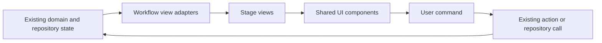

> **Archival record:** Preserved historical design/evidence from its original point in time. It does not claim Hermes integration is implemented.

# Studio Canvas UI Redesign Design

## Status

Approved through visual review on 2026-07-16.

## Goal

Redesign the AI test platform as a refined, calm, and efficient desktop workbench. The first implementation slice covers the complete requirement-to-execution workflow:

`需求导入 -> 内容解析 -> AI 生成 -> 质量评审 -> 保存 / 执行`

This workflow becomes the visual and interaction reference for later migration of the case library, API automation, Web automation, reports, defects, AI settings, and template settings.

Priority order is:

1. Visual quality and product identity.
2. Operational efficiency.
3. Information organization.

## Users And Context

Primary users are QA engineers and test leads working for long periods on dense desktop screens. Backend and API developers may also use generated cases and automation results. The interface must support scanning, comparison, editing, and repeated actions without becoming visually heavy.

The product remains desktop-first. Mobile-sized layouts only need to preserve functional access; they do not need to reproduce the desktop table-editing experience.

## Scope

The first redesign slice includes:

- The global application shell and primary navigation.
- Light theme tokens and a theme-mode interface.
- The requirement import, parsing, generation, review, save, and execution workflow.
- Loading, empty, partial-success, error, offline, and sync-conflict states for that workflow.
- Desktop responsive behavior, keyboard behavior, and accessibility requirements.
- Shared presentational components needed by the workflow.

The first slice does not include:

- A backend rewrite or API contract change.
- A rewrite of existing domain and repository behavior.
- Full dark-theme visual implementation. The theme contract must support it, but the approved visual work is light-theme first.
- Pixel-equivalent mobile table editing.
- A simultaneous visual rewrite of every platform module.

## Design Direction

The approved direction is **Studio Canvas**: a light, gentle task canvas influenced by Figma-like focus and tool clarity. It must remain operational rather than decorative.

The design combines:

- Soft neutral page and panel surfaces.
- Low-noise borders and restrained elevation.
- A small amount of configurable brand color for primary actions and AI focus.
- Independent status colors for success, warning, failure, and information.
- Clear task stages and contextual panels instead of permanently showing every control.

The UI must avoid oversized headings, decorative dashboard cards, large empty areas, nested cards, heavy enterprise component styling, and a page dominated by one hue. Brand color is an accent, not a background theme.

## Theme Contract

### Modes

The theme contract accepts three preferences:

- `light`: implemented and used by default in the first redesign slice.
- `dark`: reserved by the token contract for later implementation and resolves to `light` until an approved dark palette exists.
- `system`: reserved for `prefers-color-scheme`; it resolves to an implemented palette and therefore resolves to `light` until dark tokens exist.

The preference contract and token slots are established in the first slice, but the UI does not expose a theme switch until more than one approved palette is available. When theme switching is enabled, the preference is stored locally and the root element exposes the resolved theme through `data-theme`. Components consume semantic tokens and never branch on theme names.

### Configurable Brand Color

Violet is the approved default for primary actions and AI focus, but it is not hard-coded into components. A central brand token bundle provides at least:

- `--brand-primary`
- `--brand-primary-hover`
- `--brand-primary-active`
- `--brand-primary-soft`
- `--brand-primary-contrast`
- `--focus-ring-color`

Changing the bundle must update custom components and the mapped Element Plus primary-color variables together. Status colors do not derive from the brand color.

Default light-theme values are:

| Role | Default | Use |
| --- | --- | --- |
| Graphite | `#252831` | Primary text and rare deep surfaces |
| Brand violet | `#6F52DD` | Primary commands and AI focus |
| Mint | `#2AA589` | Success and completed states |
| Amber | `#E9AD55` | Warnings and pending confirmation |
| Rose | `#D95C72` | Errors and destructive states |
| Sky | `#5B9CCB` | Informational states |
| Fog | `#F4F5F8` | Page background |
| White | `#FFFFFF` | Main work surfaces |

The target visual ratio is approximately 80% neutral surfaces, 15% semantic status color, and no more than 5% brand color. Decorative gradients are not part of the product language.

### Typography, Shape, And Motion

- Use the current system-first font stack with `PingFang SC` and `Microsoft YaHei` fallbacks.
- Use stable font sizes; do not scale typography with viewport width.
- Use `6px` to `8px` radii for standard controls and panels.
- Prefer borders and surface contrast over shadows. Reserve soft shadows for overlays and raised transient surfaces.
- Keep standard motion between `120ms` and `180ms` and honor `prefers-reduced-motion`.
- Use Lucide icons for navigation and commands. Icon-only controls require `aria-label`, `title` or Tooltip, and a visible focus state.

## Application Shell

### Primary Sidebar

The sidebar has two user-controlled states:

- Collapsed: `56px`, icons only, with Tooltips.
- Expanded: `168px`, icons plus text titles.

The expanded width is fixed and must fit the longest approved navigation label without truncating ordinary Chinese text. The last user selection is persisted.

Navigation is grouped as:

- `测试设计`: 智能用例设计, 用例库.
- `自动化`: API 自动化, Web 自动化.
- `质量洞察`: 执行报告, 缺陷管理.
- `配置`: AI 设置, 模板与字段.

The active item uses a soft brand surface, brand-colored icon, and a narrow left indicator. Navigation icons remain visible in both states. Counts are visible only where they carry operational value.

The sidebar toggle does not live in the brand area and does not float over the sidebar divider. It is the first command in the main global top bar and uses Lucide `PanelLeftClose` and `PanelLeftOpen`. Its position and hit area remain stable across sidebar states.

### Global Top Bar

The top bar contains, in order:

1. Sidebar layout control.
2. Current project and module context.
3. Global search.
4. Global utilities. A theme preference entry occupies this area only after more than one approved palette is available.
5. User identity.

Global navigation and project context remain stable while users move between task stages.

### Task Header

The task header contains:

- Task name.
- Automatic-save state and timestamp.
- The five-stage workflow stepper.
- A secondary draft command when relevant.
- Exactly one stage-specific primary command.

The stepper makes `内容解析` visible even though it is a system-heavy phase. Users may return to completed stages without losing later work. Moving backward never silently discards generated or reviewed cases.

## Adaptive Task Canvas

The current fixed three-column layout becomes a stable shell with contextual work areas.

- The central canvas always owns the current task's primary content.
- A left context pane appears for sources, document structure, modules, or interfaces when those resources are relevant.
- A right inspector appears for AI findings, evidence, validation, or delivery configuration when the current stage needs it.
- Context panes disappear or become drawers when they are not useful or when space is constrained.

This prevents persistent resource panes from taking space during stages where they have no purpose.

## Core Workflow

### 1. Requirement Import

The import stage supports combining multiple sources in one task:

- Requirement documents and images.
- Figma designs.
- OpenAPI documents.

The left context pane lists sources and their individual readiness states. The central canvas offers explicit source commands using icons and concise action labels. A preflight check validates readability, format, and authorization before enabling `解析需求`.

Failure is source-local. One failed source does not remove successful sources. The failed item exposes retry, replace, and remove actions in place.

### 2. Content Parsing

Parsing is a visible, resumable task stage. It shows:

- Current parsing phase.
- Completed source count and total source count.
- Extracted document sections, Figma nodes, or API operations as they become available.
- Local errors attached to the affected source.

Long parsing continues if the user leaves the current screen. Returning to the task restores the latest known progress. Partial results remain available when one source fails.

### 3. AI Generation

The generation stage defaults to the parsed scope. Users can narrow the scope by document section, Figma area, module, or API operation.

Frequently used controls stay near the result canvas:

- Generation kind.
- Case template.
- Generation depth or granularity.

Low-frequency model or advanced controls live in a drawer and do not compete with the primary task.

`生成用例` is the only primary command. Results appear incrementally so users can begin inspection before the whole run finishes. Progress includes stage, generated count, expected count when available, and recoverable failures.

### 4. Quality Review

The review stage uses:

- A central case table or editor.
- A contextual source and document outline on the left when evidence navigation is useful.
- An AI quality inspector on the right.

The default view prioritizes pending confirmation, conflicts, coverage gaps, and high-risk findings. Selecting a case updates the inspector to show only relevant evidence and suggestions. Each finding supports appropriate actions such as locate source, accept, modify, mark pending, or ignore.

Review decisions support bulk operations. Color is not the only state signal; labels and icons accompany every status.

Unresolved high-risk findings do not block saving. They must be summarized explicitly before automation execution.

### 5. Save And Execute

The final stage presents a delivery summary and two independent outcomes:

- Save to the case library. This is the default and preserves source and review traceability.
- Convert selected cases to API or Web automation, validate executability, select an environment, and optionally execute.

Saving and execution are separate transactions. An execution failure never rolls back cases that were successfully saved. Execution remains disabled until environment and executability preflight checks pass, with missing prerequisites shown next to the disabled action.

## Data And Action Flow

The redesign is a presentation and workflow-composition change. Existing domain and repository modules remain the source of business behavior.

Workflow view adapters derive display-ready stage state, counts, labels, disabled reasons, and local error summaries. They do not duplicate parsing, generation, persistence, automation, or synchronization rules.

## Component Boundaries

Shared presentational components should have narrow interfaces and no domain persistence responsibility:

- `AppShell`: sidebar, top bar, and main content geometry.
- `PrimarySidebar`: navigation groups, collapsed state, active route, and counts.
- `GlobalTopbar`: layout toggle, project context, search, theme entry, and user utilities.
- `TaskHeader`: task identity, save state, stepper, and stage actions.
- `WorkflowStepper`: stage labels, status, and safe navigation events.
- `ContextPane`: stage-specific resource navigation.
- `TaskCanvas`: stable main-work-area container.
- `AIInspector`: findings, evidence, and review actions.
- `StateView`: loading, empty, filtered-empty, local error, and partial-success variants.
- `ResponsiveDrawer`: compact-desktop presentation for context panes and inspectors.

Stage views compose these pieces for import, parsing, generation, review, and delivery. Existing domain functions and repository adapters remain outside shared UI components.

Because `App.vue` currently owns a large amount of state and markup, extraction must be incremental. Each extracted component receives explicit props and emits user intent; it must not silently copy persistence or navigation logic into a second location.

## Feedback And Recovery

### Loading

- Use skeletons for short content loads.
- Use determinate progress when counts are known.
- Use stage-based progress for long AI, parsing, and execution tasks.
- Long tasks must remain visible in task status after navigation.

### Empty States

- First-use empty states provide one clear next action.
- Filtered-empty states preserve filters and provide `清除筛选`.
- Empty state copy stays concise and operational.

### Errors And Partial Success

- Bind errors to the source, case, request, or execution item that failed.
- Preserve successful results.
- Offer a local retry when retry is safe.
- Summarize partial completion as completed count, failed count, and next available action.
- Use dialogs only for destructive confirmation or decisions that cannot be recovered inline.

### Persistence And Sync

- Draft state is automatically saved and the most recent save time stays visible.
- Backend unavailability does not block local-first workflow use.
- Existing local-versus-backend conflict handling remains available through a compact contextual notice with push-local and reload-backend actions.

## Responsive Rules

### Wide Desktop: `>= 1440px`

- Respect the persisted sidebar state.
- Allow the context pane, central canvas, and inspector to appear simultaneously.
- Keep stable column widths and let the central canvas absorb extra space.

### Standard Desktop: `1180px` To `1439px`

- Respect the persisted sidebar state.
- Reduce context and inspector widths within defined minimums.
- Do not compress navigation labels, control labels, table row heights, or typography.

### Compact Desktop: `900px` To `1179px`

- Default a first-time user to the collapsed sidebar without overriding an existing preference.
- Present context panes and inspectors as drawers.
- Preserve table readability through controlled horizontal scrolling where necessary.

### Below `900px`

- Preserve navigation, status inspection, and basic commands.
- Use a navigation drawer and stacked content.
- Do not promise full desktop table-editing parity in the first redesign slice.

## Accessibility

- Target pragmatic WCAG 2.1 AA contrast for text, controls, and states.
- Make navigation, workflow stages, tables, drawers, dialogs, and actions keyboard reachable.
- Keep focus order aligned with visual order and show a visible focus ring.
- Pair every status color with text or an icon.
- Provide semantic labels for forms and icon-only commands.
- Keep Tooltip content supplemental; essential information must remain available without hover.
- Respect reduced-motion preferences.

## Implementation Sequence

1. Introduce semantic light-theme tokens, Element Plus mappings, and the `light | dark | system` preference contract with a safe light fallback.
2. Build the shared application shell, `168px / 56px` sidebar, top-bar toggle, task header, and responsive context containers.
3. Migrate requirement import and parsing into the new workflow shell without changing domain behavior.
4. Migrate AI generation with incremental progress and stage-local state views.
5. Migrate quality review with the contextual AI inspector and evidence linking.
6. Migrate save, automation conversion, environment preflight, and execution handoff.
7. Apply the approved shell and component language to remaining modules one workflow at a time.

Each sequence step must leave the application usable. Visual migration must not require all modules to move at once.

## Verification

Automated checks must cover:

- Sidebar expansion, collapse, persisted preference, and route navigation.
- The `light`, `dark`, and `system` contract, including safe fallback to `light` while only the light palette is approved.
- Brand token mapping into custom components and Element Plus.
- Safe workflow-stage navigation and draft restoration.
- Source-local parsing failures and partial success.
- Incremental generation status and recovery.
- Review selection-to-inspector synchronization and bulk decisions.
- Saving independently from automation execution.
- Disabled execution reasons and environment preflight.
- Keyboard navigation and visible focus behavior for critical controls.

Screenshot and browser verification must cover at least:

- `1440x900`: expanded and collapsed navigation, import, review with both context panes, and delivery.
- `1280x800`: complete core workflow and long Chinese labels.
- `1024x768`: collapsed navigation, context drawer, inspector drawer, and table overflow.
- Loading, first-use empty, filtered-empty, local error, partial success, offline, and sync-conflict states.

Screenshots must be checked for blank areas caused by rendering failures, text overflow, incoherent overlap, layout shift, and action labels that do not fit their controls.

## Acceptance Criteria

The first redesign slice is complete when:

- The approved Studio Canvas light theme is consistently applied to the core workflow.
- The brand accent can be replaced centrally without editing individual components.
- The sidebar works at `56px` and `168px`, shows icons plus titles when expanded, and uses the top-bar panel toggle.
- Users can complete import, parsing, generation, review, save, and optional execution without returning to the old workspace layout.
- Each stage has one unambiguous primary action.
- Long tasks, local failures, partial success, offline use, and sync conflicts remain recoverable.
- Existing domain behavior and persistence paths continue to pass their tests.
- Required desktop screenshots and interaction checks pass without overflow or overlap.

There are no unresolved design questions for the first implementation slice.
