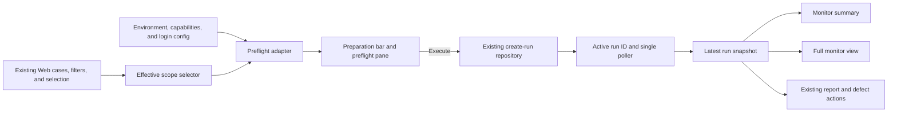

> **Archival record:** Preserved historical design/evidence from its original point in time. It does not claim Hermes integration is implemented.

# Web Automation Studio Workbench Design

## Status

Approved on 2026-07-27.

## Goal

Redesign the Web automation page as a focused execution workbench that follows the approved Studio Canvas visual language. The default page must make the primary workflow obvious:

```text
Select scope and cases -> prepare the environment -> execute -> monitor progress -> inspect results
```

The redesign keeps the current Web Runner, repositories, run controls, reports, and defect flow. It changes information architecture, component composition, and presentation without duplicating execution behavior.

## Confirmed Decisions

- Use the approved light Studio Canvas theme: soft white and cool-gray surfaces, deep blue primary actions, teal success/readiness accents, and amber warning accents. Purple is not a primary color.
- The default page uses the approved right-monitor workbench layout.
- Clicking the monitor summary opens a full-canvas live monitor similar to the approved monitor-first concept.
- Starting a run does not force the user into the full monitor.
- The primary action uses the selected-or-filtered rule:
  - if rows are selected, execute the selected rows;
  - otherwise, execute the current filtered result;
  - always show the effective count in the button label.
- When no run is active, the right pane shows execution preflight instead of historic metrics or an empty placeholder.
- Remove the four current metric cards and duplicate project/module filters.
- Remove the in-page API/Web automation type switch. The primary sidebar remains the only module-level switch between API automation and Web automation.
- Keep API automation behavior outside this redesign. The Web automation workspace may be extracted from the shared conditional markup, but the API automation page is not redesigned in this slice.

## Non-Goals

- Changing Runner HTTP contracts or execution semantics.
- Adding new browser engines, scheduling, distributed execution, or persistent run history.
- Redesigning API automation, reports, defects, environments, or the case library.
- Replacing Element Plus or changing backend persistence.
- Rebuilding the application shell already approved for Studio Canvas.

## Page Modes

### Workbench Mode

Workbench mode is the default Web automation view. It combines execution preparation, scope selection, case selection, and a contextual right pane.

The page is organized into four horizontal and vertical bands:

1. Task header.
2. Execution preparation bar.
3. Left run-scope pane.
4. Center case table and right contextual pane.

### Full Monitor Mode

Full monitor mode replaces the workbench canvas within the Web automation module. It is not a separate product module and does not open a new browser window.

The view contains:

- a return command that restores the workbench state;
- run identity, lifecycle status, elapsed time, and selected browser;
- pause, resume, stop, and rerun controls when allowed;
- the latest browser screenshot as the primary surface;
- setup, test, and teardown timeline phases;
- current case, step, URL, action, diagnostics, and screenshot timestamp;
- passed, running, pending, failed, and error case counts.

Entering or leaving the full monitor never pauses the run. The monitor summary and full monitor consume the same run snapshot and the same polling lifecycle.

## Information Architecture

### Task Header

The task header displays:

- `Web 自动化` as the literal page title;
- concise scope metadata such as executable case count, module count, and latest run time;
- secondary commands for run history and generating from the case library;
- low-frequency commands such as export in an overflow menu.

The header does not repeat the global page breadcrumb and does not contain large metric cards.

### Execution Preparation Bar

The preparation bar keeps the controls required for the next run in one row:

- Web execution environment;
- browser override or follow-environment choice;
- repeat count;
- login-session readiness;
- the primary execution action.

The primary action label must name the effective scope, for example:

- `执行选中 3 条`
- `执行当前 12 条`

The command is disabled when the effective scope is empty or when a blocking preflight issue exists. The disabled reason is shown next to the relevant preflight item.

### Run Scope Pane

The left pane owns project and module scope. Project selection appears once, followed by module counts. The center toolbar must not repeat project and module controls.

Changing project or module updates the center case table and effective execution scope. Existing selection behavior must be made explicit: rows no longer present after a scope change are removed from the effective selection.

### Case Table

The center table prioritizes execution readiness rather than exposing every stored field. Its default columns are:

- selection;
- case ID and name;
- page;
- browser resolution;
- executability or latest run status;
- compact row actions.

The toolbar contains only table-local controls such as source, status, and keyword. Bulk actions appear only when rows are selected. Destructive scope deletion must not compete visually with the primary execution command.

Detailed steps, locators, assertions, and metadata remain in the existing detail or edit surface rather than widening the default table.

### Contextual Right Pane

The right pane has two states.

#### Idle: Execution Preflight

The pane checks:

- Runner availability;
- selected browser availability;
- environment address and runtime validity;
- automatic login and teardown configuration;
- effective case count and executability.

Each check has a text label, status icon, and local repair command where possible. Color is supplemental and never the only signal.

#### Active Or Terminal Run: Monitor Summary

The same pane changes in place to show:

- run status and progress;
- latest screenshot thumbnail;
- current case and step;
- latest diagnostic when relevant;
- an explicit `进入实时监控` command.

Terminal runs retain their summary until the user starts another run or intentionally clears the active run context.

## Interaction Rules

### Effective Execution Scope

The execution scope is derived in this order:

1. Use selected rows when at least one currently visible row is selected.
2. Otherwise use the current filtered rows.
3. Disable execution when the derived list is empty.

The derived count, preflight count, and primary-action label must use the same selector so they cannot drift.

### Starting A Run

1. Resolve the effective execution scope.
2. Evaluate preflight readiness.
3. Keep all configuration and selection state when preflight fails.
4. Create the run through the existing repository when preflight passes.
5. Bind the returned run ID to the existing poller.
6. Replace preflight with the monitor summary without changing page mode.
7. Enter full monitor mode only after explicit user action.

### Monitor Navigation And Recovery

Workbench and monitor are two views of the same Web automation task. Returning to the workbench preserves:

- project and module scope;
- table filters;
- selected rows;
- table scroll position;
- active run and latest snapshot.

Persist the active run ID in session storage so a reload in the same browser tab can reconnect without creating a new run. Full monitor mode uses the query state `view=monitor&runId=<id>` under the existing automation path. Returning to the workbench removes the monitor query without clearing the active run ID. Loading either view validates the stored or queried ID through the existing run endpoint and clears stale recovery state when the Runner reports that the job no longer exists. Only one poll request may be active at a time.

## Component Boundaries

New presentational components should remain narrow and emit user intent:

- `WebAutomationWorkspace`: composes the approved workbench regions.
- `WebAutomationTaskHeader`: title, scope metadata, and secondary actions.
- `WebRunPreparationBar`: environment, browser, repeat count, login readiness, and effective execution command.
- `WebAutomationScopePane`: project and module scope.
- `WebAutomationCaseTable`: table-local filters, selection, readiness, and row actions.
- `WebRunPreflightPanel`: display-ready readiness checks and repair events.
- `WebRunMonitorSummary`: compact active or terminal run status.
- `WebRunMonitorView`: full-canvas screenshot, timeline, details, and run controls.

`App.vue` remains the orchestration owner during this slice. Existing repository calls, polling, environment persistence, report mapping, and defect conversion must not be copied into these components.

Display adapters may derive:

- effective run scope and button label;
- preflight items and blocking reason;
- current monitor mode;
- progress, phase, lifecycle label, and allowed controls.

Adapters do not mutate persistence or start runs.

## Data Flow



## Run State Model

The presentation maps existing Runner states into the following user-facing flow:

```text
Preparing -> Ready -> Starting -> Running <-> Paused
                                     |          |
                                     +----------+-> Stopped
                                     +------------> Completed
                                     +------------> Failed
                                     +------------> Interrupted
```

`Interrupted` represents a lost or unavailable Runner job. A polling transport error initially remains a retrying connection state and does not rewrite the Runner lifecycle status.

## Feedback And Recovery

### Preflight Failure

- Show the failure on the affected check.
- Preserve execution configuration, filters, and selection.
- Provide a local repair or retry command.
- Avoid a blocking modal unless external confirmation is unavoidable.

### Run Creation Failure

- Keep the workbench unchanged.
- Show a concise local error near the execution action and preflight pane.
- Allow retry without rebuilding the selection.

### Polling Interruption

- Retain the last good screenshot, timeline, and progress.
- Show `连接中断` or `正在重连` separately from the run lifecycle status.
- Use the existing bounded retry behavior and never create a second poller.

### Runner Restart Or Missing Run

- Mark the view as `执行已中断`.
- Preserve locally held evidence for the current page session.
- Offer rerun and return-to-workbench actions.

### Pause And Stop

- Explain that pause and stop take effect after the current step boundary.
- Keep controls disabled while the command is in flight.
- Never claim a paused or stopped state before the Runner confirms it.

### Partial Results

- A failed case does not stop later cases unless the existing Runner policy requires it.
- Completed case evidence remains visible.
- Failed or errored cases link to logs, reports, and defect conversion.

## Empty States

- No Web automation cases: show one primary command to generate from the case library.
- Filtered empty: preserve filters and offer `清除筛选`.
- No active run: show execution preflight, not a blank monitor.
- Waiting for first screenshot: keep progress and current phase visible with concise waiting text.
- No timeline entries yet: show the current lifecycle phase instead of an empty table.

## Responsive Behavior

### Wide Desktop: `>= 1440px`

- Show scope, table, and contextual right pane together.
- Keep the right pane approximately `280-320px` and let the table absorb extra width.

### Standard Desktop: `1180-1439px`

- Keep all three regions visible with narrower side panes.
- Use controlled horizontal scrolling for the case table.
- Do not shrink control labels or button text below the approved type scale.

### Compact Desktop: `900-1179px`

- Use the existing collapsed primary sidebar behavior.
- Move run scope and the contextual monitor/preflight pane into responsive drawers.
- Keep the preparation bar and primary execution command visible.

### Below `900px`

- Use the existing navigation drawer.
- Stack preparation controls without changing their meaning.
- Preserve filtering, execution, status inspection, and full monitor access.
- Full monitor uses the available canvas and stacks screenshot, timeline, and details.
- Full desktop table-editing parity is not required in this slice.

## Accessibility

- Keep keyboard focus order aligned with visual order.
- Restore focus to the monitor entry after returning from full monitor mode.
- Give icon-only commands accessible names and tooltips.
- Pair every color state with text and an icon.
- Announce run lifecycle and connection-state changes without repeatedly announcing polling updates.
- Respect reduced-motion and increased-contrast preferences.
- Make drawers and full monitor controls keyboard reachable with visible focus rings.

## Verification

### Unit And Component Tests

- Selected rows take precedence over filtered rows.
- Filtered rows are used when selection is empty.
- Effective count, preflight count, and button label cannot disagree.
- Empty effective scope disables execution with a reason.
- Preflight maps Runner, browser, environment, and login states correctly.
- Monitor summary and full monitor use the same snapshot.
- Only one polling loop is active across view changes.
- Pause, resume, stop, retry, and interrupted states expose correct controls.
- Returning from monitor mode preserves workbench state.

### Browser Tests

- `1440x900`: full three-column workbench, idle preflight, active summary, and full monitor.
- `1280x800`: long Chinese labels, table overflow, selected and filtered execution labels.
- `1024x768`: collapsed navigation, scope drawer, preflight/monitor drawer, and full monitor.
- `390x844`: stacked preparation, execution access, and monitor inspection without clipping.
- Keyboard navigation, focus restoration, reduced motion, and pragmatic WCAG 2.1 AA checks.
- No-cases, filtered-empty, preflight failure, creation failure, partial result, polling retry, interrupted run, and terminal states.

### Completion Checks

- Run the complete frontend unit suite.
- Run the complete Playwright suite and update approved snapshots.
- Run `npm run build` independently from tests.
- Run `git diff --check`.
- Keep the local preview available for visual review.

## Acceptance Criteria

- A user can understand the next execution action without scanning metric cards or duplicate filters.
- The effective run scope is always explicit before execution.
- Blocking readiness issues are visible before the run starts.
- Starting a run keeps the user in the workbench and immediately exposes monitor status.
- The user can enter a full live monitor and return without losing workbench state.
- Workbench and monitor never create duplicate polling loops.
- Existing pause, resume, stop, report, and defect behavior remains available.
- The redesigned page matches the approved Studio Canvas theme and responsive rules.

## Visual References

The approved visual references are retained under:

- `docs/superpowers/design-assets/web-automation/01-layout-directions.html`
- `docs/superpowers/design-assets/web-automation/02-hybrid-workbench-monitor.html`
- `docs/superpowers/design-assets/web-automation/03-final-workbench-detail.html`
- `docs/superpowers/design-assets/web-automation/03-final-workbench-detail.png`

The final implementation screenshots must be committed with the browser regression baselines so visual drift can be detected later.
